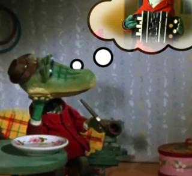

import Table from "@components/Table.astro"
import ItemBox from "@components/ItemBox.astro"
import * as layoutStyles from '../../../../components/layout.module.css'
import TierMark from "@components/TierMark.astro"

We've received another legendary class item! Hooray! This month, it's time to appreciate the finer points of being an Accordion Thief, as well as the finer points of being a tree: we've received the **legendary acorndion**. As a huge fan of corn, I am obligated to stan for this acorn item, even if TPTB forgot to put the space between "a" and "corn". I am also a big fan of Crocodile Gena, from the television show *Cheburashka*, who has wistfully dreamed of this accordion for all his life. But is the IOTM good enough to stan? Great question. Let's find out!

## General Summary
The **legendary acorndion** is a two-handed ranged weapon that is auto-pulled at the start of each run. As with January's <a href="/analysis/2026-01-legendary-seal-clubbing-club">legendary seal-clubbing club</a> and May's <a href="/analysis/2026-05-legendary-pasta-wand">legendary pasta wand</a>, the acorndion is styled with orange text and a black background, which is why I did that weird formatting above. The acorndion features the following enchantments:

<ItemBox itemName="legendary acorndion">
- Moxie +10
- +30% Booze Drops from Monsters
- +10 damage to Accordion Thief Combat Skills
- +3 Stat(s) Per Fight
 
- Buffs up (or grants access to lesser versions of) AT Combat Skills
- Keep 1 additional song in your head (AT only)
</ItemBox>

With the acorndion in your inventory, all Accordion Thief songs will produce buffs of 15 turns when cast. The buffed up combat skills will be covered later, as they are somewhat complex; using them spends an acorn to create a benefit within a specific zone. You have 12 acorns to use each day, and each zone can get 3 acorns applied on a daily basis. 

## Speedrun Applicability

First, we can quickly cover the enchantments. They aren't great! As with all accordions, the AT skill [Accordion Appreciation](https://wiki.kingdomofloathing.com/Accordion_Appreciation) doubles the numeric enchantments on this accordion. This is largely cosmetic, as most of these are bad enchantments, but 60% booze drop is decent in a vacuum. However, if you happen to own a <a href="/analysis/2026-07-cup-of-13s">Cup of 13s</a>, you'd prefer to just equip that, as the acorndion is a two-handed item and the Cup gives 60% booze drop using just the off-hand slot. The extra song slot is fun in theory but rather useless in practice; it only counts when the acorndion is equipped, and as it is two-handed, it will rarely be used.[^1] All things considered, this isn't a meaningful part of the item's value. 

The real value from this IOTM comes from the improved combat skills. For the six guild-purchasable AT combat skills[^2], casting those will cause an acorn to pop out of the acorndion and plant itself in the zone. What that acorn then does varies by the zone's environment type; KoL zones can either be indoors, outdoors, underground, or underwater.[^3] 

First, for reference, here are the base effects of the combat skills.

<Table compact widths={["4em", "12em", null]} highlight={{ columns: { Skill: "shade" } }}>

| Level | Skill | Normal effect |
| :---: | ----- | ------------- |
| 1 | Dissonant Riff | Damages and weakens your opponent (4-6 damage, 4 attack/defense reduction) |
| 2 | Cadenza | [Unleash your accordion's unique inner strength](https://wiki.kingdomofloathing.com/Cadenza) (usable once per fight) |
| 4 | Accordion Bash | Stuns your opponent by hitting them with your accordion |
| 6 | Concerto de los Muertos | Deals Spooky damage over a few rounds (usable once per fight): X+12 to X+15 damage with an accordion equipped, where X is the accordion's max damage |
| 9 | Bawdy Refrain | Deals Sleaze damage; with an accordion equipped, deals (base accordion damage) + (0.35 × Mox) |
| 12 | Cone of Zydeco | Deals Physical damage; with an accordion equipped, deals (base accordion damage) + (0.4 × Mox) physical damage |

</Table>

Next, here are the in-zone effects spawned by using those six skills with the legendary acorndion equipped. 

<Table 
  widths={["16%", "21%", "21%", "21%", "21%"]}
  highlight={{
    columns: { Skill: "shade" },
    cells: [
      { row: "Accordion Bash", column: "Indoor Acorn", color: "best" /* banish */ }, 
      { row: "Concerto de los Muertos", column: "Underwater Acorn", color: "best" /* banish */ },
      { row: "Concerto de los Muertos", column: "Underground Acorn", color: "good" /* weird sniff */},
      { row: "Cone of Zydeco", column: "Outdoor Acorn", color: "good" /* +item */},
      { row: "Cadenza", column: "Outdoor Acorn", color: "good" /* -5% combat */ },
      { row: "Accordion Bash", column: "Underwater Acorn", color: "good" /* -10% combat */ },
      { row: "Bawdy Refrain", column: "Indoor Acorn", color: "best" /* bridge parts */ },
    ],
  }}
  >

| Skill | Indoor Acorn | Outdoor Acorn | Underground Acorn | Underwater Acorn |
| ----- | ------------ | ------------- | ----------------- | ---------------- |
| Dissonant Riff | Monsters take 10-20 damage each round | Weaken monsters by 30% | +15% to all Stat Gains from fights in this zone | Monsters take 10-20% of their HP in damage each round |
| Cadenza | Damage Taken from Monsters -40% | Monsters will be less attracted to you (-5%) | All Attributes +100% | Occasionally find sea fruit after fights | 
| Accordion Bash | This monster will no longer appear in this zone specifically | Monsters start each fight with 25% less HP | Occasionally find fruit after fights | Monsters will be much less attracted to you in this zone |
| Concerto de los Muertos | Monsters take 10-20 Spooky damage each round | Monsters will sometimes be too tangled up to attack you | This monster will occur 4x as often in this zone | This monster will no longer appear in this zone specifically |
| Bawdy Refrain | Occasionally find smut orc bridge building materials | Monsters take 10-20 Sleaze damage each round | Restores 20-30% HP and 10-20% MP after fights | Sea cows will appear in this zone specifically | 
| Cone of Zydeco | +50% Initiative in this zone | +30% Item Drops in this zone | Monsters are stunned for the first 3 rounds of each fight | Underwater pressure -30% |

</Table>

I've highlighted a few of the most notable effects; gold for the best effects, light green for other notable ones. Please note that all effects occur specifically within the zone where the skill was used. This applies to everything, including the banishes -- for instance, if you use an acorn to banish pygmy orderlies in the Hidden Bowling Alley, those orderlies will not be banished in the Hidden Hospital. This is unique; we've never had a banish quite like it! 

## Acorns & Where to Plant Them

Having generated the table of acorn uses, it's worth talking through the best acorns to plant. I have highlighted two of the top-tier uses in the table above in gold, which you'll likely want to use in every run.

First, the **banish**, generated by using the Accordion Bash indoors or the Concerto de los Muertos underwater. This is not a free-run banish, so it isn't necessarily as valuable as those that freely end a combat. It's still useful, though. It functions similarly to Spring Kick from <a href="/analysis/2024-02-spring-shoes/">the Spring Shoes</a>. This means you can banish a monster while still successfully resolving a combat with said monster. That's a nice little trick! It allows you to winnow down the available monsters while still letting you get a shot at their drops. Since it's indoors-only (apart from your single underwater Monodent-powered zone each day), here is a list of relevant zones you might end up using this ability in, with a few targets per zone:
- **Haunted Library** (banshee or bookbat)
- **Haunted Bedroom** (all non-elegant nightstands)
- **The Red Zeppelin** (man with the red buttons or red skeleton)[^4]
- **The Penultimate Fantasy Airship** (... anything, really, but only after you flood the place!)

Second, the **bridge parts** generated by using Bawdy Refrain indoors. Once used, at the end of every fight in that zone, the game will roll for a chance to generate bridge parts (1 lumber + 1 fastener), at a probability of `50% - 5% * num_drops_today`. This is quite nice, although it is not necessarily going to save as many turns as it may seem. That `num_drops_today` variable is shared across all zones, which means the chances of seeing bridge parts fall pretty dramatically as you get more of them. 

There are about 70-80 "resolved combats" per run in indoor zones. If you evenly split indoor turns between D1 and D2 (to maximize your bridge part chances), that's about 30 indoor turns a day. Using a simple simulator I coded up, on average, if you spend 30 indoor turns in bridge-part-generating zones, you would receive **8 activations** per day, meaning 8 lumber and 8 fasteners, with a standard deviation of 1.25. If instead you use more acorns for other boons, and have just 20 indoor turns with this acorn active each day, you would receive **6.5 activations** per day, with a standard deviation of 1.34. And if you are really trying to minimize acorn usage, and only spend 10 turns indoors with this acorn active, you would receive **4.3 activations** per day, with a standard deviation of 1.01. 

What this means is that you are quite unlikely to generate your whole bridge through this acorn use, but you are reasonably likely to get at least 5/5 each day, which is worth 2-3 turns spent in the logging camp. For reference purposes, here are my (very rough!) calculations on how many indoor turns by zone you have available in a modern speedrun:

<Table highlight={{ columns: { "Indoor Zone": "shade" } }}>

| Indoor Zone | Turns Spent | Breakdown |
| ---- | :----------: | --------- |
| Copperhead Club | ~12 | |
| Giant's Castle (Ground) | ~10 | |
| CyberRealm | 10 | Each day; must encounter a hacker to plant the acorn |
| Spookyraven Manor | ~29 | Kitchen 7, Library 5, Bedroom 3, Bathroom/Gallery 10, Ballroom 4 |
| The Hidden City | 23 | Apartment 8, Office 9, Bowling Alley 3, Hospital 3 |
| The Red Zeppelin | 7 | |
| Lair of the Ninja Snowman | 3 | |

</Table>

Having gone through the two best acorns, let's cover the next-best acorns that may still warrant picking in some situations.

The two **noncombat rate** acorns are pretty nice. Both go quite well with the Penultimate Fantasy Airship, as you need to crank the NC rate up in that zone, and in modern Standard you tend to want to use ink bladders in the airship anyway, making it an easy underwater conversion. In some future avatar paths, I could envision the outdoor -5% combat acorn being quite useful to soft-cap the noncombat rate in some annoying zones. Zones that seem like a good fit for this acorn include: The Spooky Forest, the Palindome, the three friar zones in the woods, the eXtreme Slope, and the Hippy Camp while you're trying to start the war. In some lower shiny sets, you may also benefit from placing it in the Mob of Zeppelin Protesters. 

The **sniff** available from playing the Concerto de los Muertos underground is also pretty nice. It has one exceedingly specific use in a speedrun: generating more Dirty Old Lihcs in the Defiled Niche. But that's a nice use, and the more sniffs you stack up on that guy, the more likely you can avoid burning a ton of banishes in the zone. One fun twist: the copies generated through this weird sniff have their names prepended with "fungal replica of". This means that you can pull an "O" out of a Dirty Old Lihc's name with the <a href="/analysis/2026-02-heartstone">Heartstone</a> when encountering the copies. Not super useful, but funny! (One other small use: it could be useful in the Wine Cellar and Laundry Room to help up the chances of hitting the cabinet and the wine rack you want while bombing out Lord Spookyraven.)

The **+30% item boost** is... fine. It isn't a huge bonus, unfortunately, though there are a few obvious zones to put it in. First, using it to boost item drops in Hero's Field within the 8-Bit Realm (where you need to hit 400% item drop to max out your score generation) is a solid use. 30% isn't a ton, but it might put you over the edge. Placing it in the Penultimate Fantasy Airship is probably fine, although not really necessary with BCZ's Refracted Gaze in the picture. Finally, it might be useful to help nudge your item drop up if you are burning turns in the Smut Orc Logging Camp; might net you an extra bridge part or so.

To put a capper on it, here are some really quick hits of limited import that are worth a single sentence apiece:

- The effect that lowers starting HP is mildly helpful for avatars that are having trouble overkilling in the Smut Orc Logging Camp.
- Sea cows are a bulky monster with high base stats; if you have nothing else, and can kill them, placing those into a delay zone may empower your leveling.

## Deciding Your Acorns

So. Lots of acorns. You have 12 to plant each day and quite a lot of different options; there's a bit of skill required to optimize which ones you use.

To simplify your decisions with the acorndion, you should first decide how much you are going to focus on bridge parts. I listed out 15 indoor zones you could reasonably use for trying to get bridge parts. That's a huge portion of your acorns! It's over the entire allotment in a 1-day run and translates to about 2/3 of your acorns per day in a 2-day run. I expect most runners will probably split the difference a bit, slicing out a few of the tinier zones from that list in favor of a few more banishes, sniffs, and NC boosts.

Each zone can only hold 3 acorns in it, but (helpfully) the acorns persist over rollover. This does include the banish. Ergo, if there's a zone you want to access on multiple days, and you are planning to plant helpful acorns in that zone, I would prioritize placing whatever you need (whether it's banishes, buffs, or some other thing) before the end of D1 to ensure they're in place for D2 and still useful during your D1.

One small annoyance with this IOTM is the fact that it is a two-handed weapon. This means that unlike most IOTMs, you are sacrificing a slot (the off-hand) in order to keep it active in any random fight. Heck, you could argue you're sort of sacrificing two slots; the enchantments are pretty awful. To this end, I would highly recommend going into your run with a pretty clear plan of where exactly you intend to use your acorns, and trying to minimize the turns the acorndion is locked to your hands. 

One other thing to keep in mind: many of these AT skills do damage. Specifically, Bawdy Refrain does quite a lot of damage, as does Cone of Zydeco. Let's be honest: you're still going to use them; Bawdy Refrain is the bridge part acorn! But this means you need to make sure that anything you need to do in the fight (using flyers, pickpocketing, banishing, etc.) happens before you shoot off either of those skills, as there's a real chance the damage from the skill itself defeats the monster. It is worth mentioning here that if you happen to -not- have the AT skills needed to plant acorns, the acorndion will give you access to damage-less versions that you can use solely to plant an acorn. This means that, somewhat unusually, it is ever-so-slightly preferable to *not* have Bawdy Refrain and Cone of Zydeco permed, as that lets you plant acorns without worrying about damage. It's a little silly, but them's the breaks.

## 2026 In-Standard Synergies

- I've already alluded to this a bit, but there's some startlingly direct synergy with the <a href="/analysis/2025-09-monodent">Monodent of the Sea</a> (2025). You can turn one zone underwater each day with the Monodent, which opens up all the underwater acorns in that zone. I don't necessarily think you'll use many of them (-com in the airship and the banish being the two mildly interesting ones), but it's a pretty cool synergy.
- The free skeleton fights spawned via the <a href="/analysis/2026-03-archaeologists-spade">Archaeologist's Spade</a> (2026) are considered in-zone, so you can use them to plant acorns and reap their benefits. This is particularly helpful for bridge parts, allowing you to plant an acorn in your first spade fight in the Haunted Kitchen and build up bridge parts as you finish the zone.

Also, one thing seems like it should be a synergy but actually isn't:

- One might think there's synergy with Embezzler leveling from the <a href="/analysis/2026-08-interesting-coin">Interesting Coin</a> (2026). Using Dissonant Riff underground increases your statgain within that zone by 15%. Embezzlers are placed underground, so in theory, this should impact the statgain. But it does not; my suspicion is that the statgain in this effect applies very specifically to stats awarded directly from fights rather than all stats earned in the combat, and the intangible asset statgain is not covered by that distinction. Not a big deal, but it's an easy way to waste an acorn, so I wanted to mention it here.

## Overall Rating

We'd rate the **legendary acorndion** a <TierMark tier={2} /> IOTM. As with many of the unique IOTMs we've analyzed this year, it's a tough one to rate. Getting the equivalent of about 2/3 of a Blech House every single day from the bridge part generation is a pretty nice little boost, probably worth 2-3 turns. The banish is probably worth another 2-ish turns per day. Everything else is pretty fractional, but it -does- have value. 

So. To answer the question: is this an IOTM worth stanning? Happily, I think I can say the answer is yes. It is mechanically novel[^5], with a good flavor. My dog might even say a crunchy flavor, since my dog cannot get enough of chomping on acorns at all hours of the day. Please stop, Duncan! Still. I think we can safely say that this IOTM has a decent amount going for it. And we can all happily play our acorndions, just like Crocodile Gena.

---

Hello, readers! Had one small thing I wanted to let everyone know about. I have put together a brand new <a href="/iotm-tiers/">IOTM Tiers</a> page! Tiers have been "explained" in brief form in the spreadsheet I've been maintaining since 2021, but The Erosionseeker has noted to me a few times over the years that the tier definitions aren't inherently obvious. Given that I allude to them in every single IOTM review, I felt it was finally time to add a tiering page to the site proper.

But I didn't JUST add the tier definitions. I also added a sortable and filter-ready tier list with ratings for all IOTMs throughout KoL's history! I added categorization for the speedrunning-relevant benefits from each IOTM, and linked to reviews for all IOTMs that have a review on this site, along with icons denoting IOTMs that are still in Standard. I hope this page is helpful and useful to everyone! Have a great November, folks!

[^1]: Also, honestly? There aren't *that* many AT songs you need to run concurrently. You have four slots with Mariachi Memory, and the primary songs of use that you essentially always want to have on are Phat Leon's (+20% item) and Polka of Plenty (+50% meat). You generally want one of the two combat frequency buffs on (either Cantata for +com or Sonata for -com), and that leaves you one slot for Ur-Kel's (+ML), Canticle (+init), or Mojomuscular (+MP) -- which can be removed when you need to cast Ode to drink some booze. Adding the most marginal buff among those into your song list is simply not that valuable.
[^2]: This excludes "Sing", the level 0 Accordion Thief combat skill.
[^3]: Small note: zoneless fights, such as the tavern rats or the misty pre-Groar Icy Peak, do not allow you to plant an acorn. The acorn can't find anywhere to land!
[^4]: If you don't have other banish sources, herring and snapper would absolutely be worth it here too; the only reason I'd (slightly) prioritize the other two is that you still gain progress towards Ron Copperhead with buttons/skeleton, while herring/snapper don't do anything for you and would be better suited for a freerun banish.
[^5]: ... ignoring the fact that this is essentially a functionally better reprint of the Florist Friar IOTM from the Order of the Green Thumb Order Form. It's still pretty novel, I think; the whole activating skill piece is interesting and a lot of these effects are unique. Adding 33 cows to a zone willy-nilly isn't super ascension relevant, but it's cool!